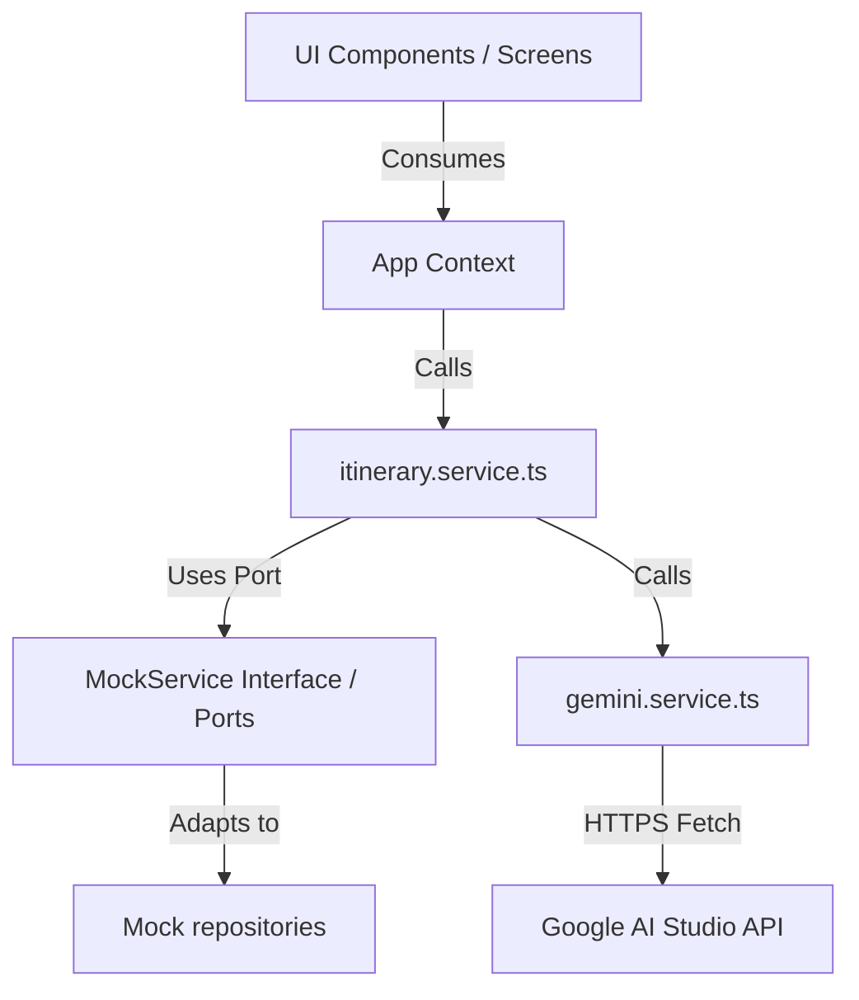

# 🌌 Antigravity — Sergipanidade Portal
> **Design-Driven Engineering Specification & System Documentation**
> 
> *A cinematographic tourism ecosystem for Aracaju, Sergipe, built under the highest standards of Apple UX aesthetics and Meta Software Engineering scalability.*

---

## 🧭 Visão do Projeto & Filosofia

O **Sergipanidade** (codinome *Antigravity*) não é apenas um portal de turismo convencional; é uma interface imersiva projetada com foco em **Design-Driven Engineering**. A experiência do usuário foi meticulosamente desenhada para parecer natural, quase invisível, utilizando contrastes marcantes, transições fluidas e espaços negativos intencionais que encantam à primeira vista. 

No backend do cliente, a arquitetura segue os princípios de robustez e alto desacoplamento da **Clean Architecture / Arquitetura Hexagonal (Ports & Adapters)**, garantindo resiliência contra falhas de rede, manutenibilidade facilitada e injeção de dependência rigorosa.

---

## 🛠️ Arquitetura de Alto Nível (RFC / Meta Standard)

A base de código está estruturada de forma modular, separando a lógica de negócios da interface gráfica e de serviços externos:



### Principais Padrões de Design Adotados
1. **Ports and Adapters (Arquitetura Hexagonal)**: Definidos em [mock.service.ts](file:///c:/Users/Matheus/Documents/Leon/mobile/sergipanidade/branch-2/frontend-sergipanidade/sergipanidade-squad-06/src/services/mock.service.ts) como interfaces de repositórios (`IHotelRepository`, `IReviewRepository`, `ICulturaRepository`, etc.) e implementados por adapters que servem dados locais simulando latência e processamento assíncrono.
2. **Singleton Pattern**: A classe [MockService](file:///c:/Users/Matheus/Documents/Leon/mobile/sergipanidade/branch-2/frontend-sergipanidade/sergipanidade-squad-06/src/services/mock.service.ts) expõe uma instância única e centralizada via `MockService.getInstance()`, garantindo que todo o sistema compartilhe a mesma fonte de dados mockados em memória.
3. **Lazy Loading**: Telas pesadas e features independentes são carregadas de forma assíncrona usando `React.lazy()` e encapsuladas em `<Suspense>` com placeholders fluidos, reduzindo drasticamente o bundle size inicial e o First Contentful Paint (FCP).

---

## 🛣️ Matriz de Rotas do Sistema

O roteamento da aplicação é construído utilizando o `react-router` de forma desacoplada no componente [AppRoutes](file:///c:/Users/Matheus/Documents/Leon/mobile/sergipanidade/branch-2/frontend-sergipanidade/sergipanidade-squad-06/src/routes/AppRoutes.tsx).

| Rota | Tela correspondente | Tipo de Acesso | Parâmetros / Props Importantes | Descrição |
| :--- | :--- | :--- | :--- | :--- |
| `/` | [LoginScreen](file:///c:/Users/Matheus/Documents/Leon/mobile/sergipanidade/branch-2/frontend-sergipanidade/sergipanidade-squad-06/src/features/auth/LoginScreen.tsx) | Público | `onLogin`, `onChangeLanguage` | Portal de autenticação com termo de cookies e LGPD. |
| `/home` | [HomeScreen](file:///c:/Users/Matheus/Documents/Leon/mobile/sergipanidade/branch-2/frontend-sergipanidade/sergipanidade-squad-06/src/features/home/HomeScreen.tsx) | Autenticado | `userProfile`, `language` | Painel central com carrossel de fotos, busca rápida e hotéis. |
| `/guia` | [GuiaScreen](file:///c:/Users/Matheus/Documents/Leon/mobile/sergipanidade/branch-2/frontend-sergipanidade/sergipanidade-squad-06/src/features/guia/GuiaScreen.tsx) | Autenticado | `onOpenGPS`, `language` | Catálogo de atrações e pontos turísticos filtráveis por região. |
| `/detalhe/:id` | [DetalheScreen](file:///c:/Users/Matheus/Documents/Leon/mobile/sergipanidade/branch-2/frontend-sergipanidade/sergipanidade-squad-06/src/features/detalhe/DetalheScreen.tsx) | Autenticado | `id` (param), `reviews`, `onAddReview` | Página detalhada do destino, galeria de fotos e avaliações. |
| `/roteiro` | [RoteiroScreen](file:///c:/Users/Matheus/Documents/Leon/mobile/sergipanidade/branch-2/frontend-sergipanidade/sergipanidade-squad-06/src/features/roteiro/RoteiroScreen.tsx) | Autenticado | `roteiro`, `onSetRoteiro`, `onOpenGPS` | Módulo gerador de itinerários personalizados (IA + Fallback). |
| `/parceiro` | [ParceiroScreen](file:///c:/Users/Matheus/Documents/Leon/mobile/sergipanidade/branch-2/frontend-sergipanidade/sergipanidade-squad-06/src/features/parceiro/ParceiroScreen.tsx) | Estabelecimento | `onToast`, `language` | Painel B2B para gestão de avaliações, selos e fotos do local. |
| `/perfil` | [PerfilScreen](file:///c:/Users/Matheus/Documents/Leon/mobile/sergipanidade/branch-2/frontend-sergipanidade/sergipanidade-squad-06/src/features/perfil/PerfilScreen.tsx) | Autenticado | `userProfile`, `onUpdateProfile` | Dados cadastrais, aba de roteiros salvos e central de privacidade LGPD. |
| `/cultura` | [CulturaScreen](file:///c:/Users/Matheus/Documents/Leon/mobile/sergipanidade/branch-2/frontend-sergipanidade/sergipanidade-squad-06/src/features/cultura/CulturaScreen.tsx) | Autenticado | `onToast`, `language` | Espaço dedicado a artistas sergipanos, histórias locais e eventos. |

---

## 🔌 Integrações e APIs Conectadas

### 1. Google Gemini AI API (Google AI Studio)
O sistema integra-se de forma direta com a API do **Google AI Studio** para a geração rápida e inteligente de roteiros de viagem customizados.

*   **Modelo de IA**: `gemini-2.5-flash` (escolhido por sua baixíssima latência de 1-2 segundos e alta taxa de acertos em geração de dados estruturados).
*   **Endpoint utilizado**: `https://generativelanguage.googleapis.com/v1beta/models/gemini-2.5-flash:generateContent?key={API_KEY}`
*   **Resiliência & Retry (429 Rate Limits)**: O serviço em [gemini.service.ts](file:///c:/Users/Matheus/Documents/Leon/mobile/sergipanidade/branch-2/frontend-sergipanidade/sergipanidade-squad-06/src/services/gemini/gemini.service.ts) calcula dinamicamente o tempo de cooldown indicado no cabeçalho/corpo de erro da API do Google (`retry in Xs`). Caso o erro ocorra, o sistema aguarda de forma assíncrona o tempo necessário (até 30 segundos) e tenta novamente.
*   **Controle de Cota**: Se a cota diária for excedida, a chamada falha de imediato para disparar o mecanismo de fallback offline.

### 2. Algoritmo Determinístico Offline (Fallback Heurístico)
Caso a API do Gemini falhe por limites de requisições, falta de internet ou erro de rede, o sistema executa de forma invisível o método `gerarRoteiroLocal` em [itinerary.service.ts](file:///c:/Users/Matheus/Documents/Leon/mobile/sergipanidade/branch-2/frontend-sergipanidade/sergipanidade-squad-06/src/services/itinerary.service.ts).
*   **Passos do Fallback**:
    1.  **Embaralhamento de semente**: Executa o algoritmo *Fisher-Yates* O(n) na lista de destinos para evitar bias e repetições entre gerações.
    2.  **Scoring de interesse**: Aplica pesos (+2 para categorias correspondentes e +1 para as demais).
    3.  **Filtragem de duplicidade**: Garante que o mesmo destino nunca seja visitado duas vezes no mesmo dia e impede consecutividade.
    4.  **Penalização Dinâmica**: Aplica uma penalidade de `1.5 pontos` na pontuação de destinos que já foram selecionados anteriormente no pool de candidatos.
    5.  **Sanitização Linguística**: Extrai apenas a primeira frase descritiva no idioma do usuário para ajustar-se perfeitamente aos cards da interface.

---

## 🔒 Credenciais e Variáveis de Ambiente

As credenciais do sistema são configuradas via variáveis de ambiente no frontend. Crie um arquivo [.env](file:///c:/Users/Matheus/Documents/Leon/mobile/sergipanidade/branch-2/frontend-sergipanidade/sergipanidade-squad-06/.env) na raiz do projeto com o seguinte formato:

```env
# Google AI Studio API Key para chamadas diretas ao Gemini-2.5-flash
VITE_GEMINI_API_KEY=SUA_CHAVE_API_AQUI
```

> [!WARNING]
> Nunca comite a chave de API real para repositórios públicos. Utilize variáveis secretas no build de produção ou mantenha em seu ambiente local protegido.

---

## 🔮 Funcionalidades em Destaque

### 📱 Smart Itinerary Planner (Wizard de Roteiro)
Um wizard de 4 passos guiará o usuário para capturar o seu perfil (`solo`, `couple`, `family`, `group`), duração da estadia, interesses e faixa de orçamento. A IA processa esses metadados e retorna uma timeline interativa organizada por períodos (`Manhã`, `Tarde`, `Noite`) com dicas altamente personalizadas.

### 🏢 Portal do Parceiro (Estabelecimentos B2B)
Um painel administrativo para negócios locais onde proprietários cadastrados podem:
*   Visualizar estatísticas em tempo real (views mensais, cliques em "Como Chegar").
*   Acompanhar a jornada de evolução para obter o **Selo de Excelência**.
*   Responder publicamente às avaliações dos turistas.
*   Adicionar fotos dos pratos ou quartos por meio de uma zona de drag-and-drop.

### 📜 Central de Privacidade e Conformidade LGPD
Integrada à tela de perfil e ao fluxo de login, o usuário possui controle total sobre suas informações de acordo com a Lei 13.709/2018 (LGPD):
*   Consentimento transparente na criação de conta.
*   Modal interativo de gerenciamento de cookies (obrigatórios, desempenho e analíticos).
*   Mecanismo de exportação de dados (Download de dados pessoais salvos).
*   Opção de exclusão permanente com prazo legal de 15 dias.

---

## 🎨 Identidade Visual & Design System

A interface do Sergipanidade foi criada inspirada no minimalismo polido da Apple e a fluidez do material design. As interações principais respondem a curvas Bezier de 4 pontos que dão peso e organicidade aos elementos gráficos.

### Cores Principais (`src/styles/theme.css`)
*   **Teal (`--teal` / `#0D7377`)**: Verde petróleo que guia as ações primárias (CTAs) e links visuais.
*   **Areia (`--areia` / `#E9D8B4`)**: Tonalidade quente do Sergipe que pinta os chips de categorias secundárias.
*   **Off-White (`--off-white` / `#F7F6F3`)**: Fundo cinza areia leve que descansa os olhos e destaca os cards.
*   **Grafite (`--grafite` / `#1E1E1E`)**: O preto suave utilizado para legibilidade máxima em telas móveis e desktops.

### Tipografia Geométrica
O sistema utiliza fontes de largura geométrica (como **Fjalla One** para grandes títulos regionais e fontes legíveis e otimizadas para corpo de texto), mantendo espaços negativos intencionais amplos para dar sofisticação de produto Premium.